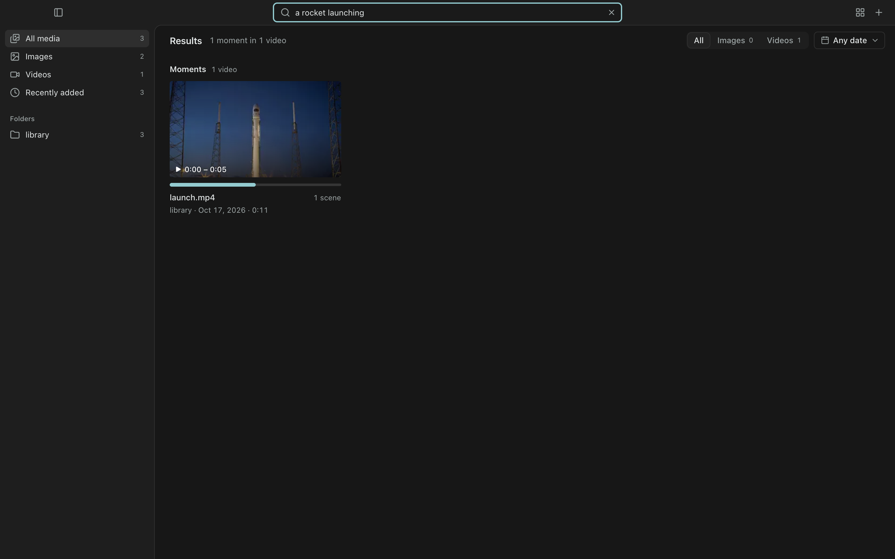
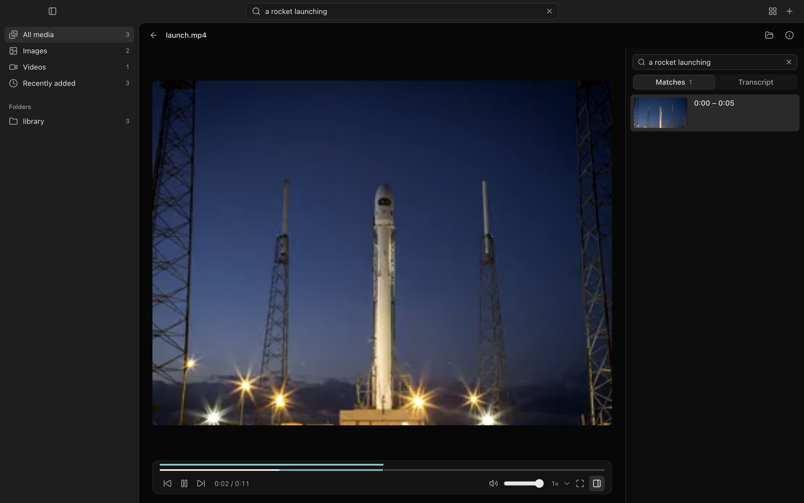

# viquery

offline desktop media library. point it at folders of photos and videos and search them by what they show, what is said, and what text appears on screen. video results land on the matching moment; inside the player, "find in this video" marks every matching scene on the timeline.

everything runs on this device. no uploads, no runtime network calls; models are fetched once at setup.




## run

```sh
npm install
npm run models   # downloads pinned, sha256-verified models (~280 MB) into ./models
npm run dev      # or npm run dev:mock for the ui with generated data
```

requires node 22+ and ffmpeg/ffprobe on PATH for development.

## how it works

- **images:** clip vit-b/32 embeddings, text read with pp-ocrv5.
- **videos:** scenes split at cuts into windows of 10 s or less, 1–3 embedded frames per window, keyframe ocr, whisper base.en transcripts.
- **search:** exact vector scan + sqlite fts5, fused with reciprocal rank fusion and relevance gates calibrated in `src/search/bench-calibration*`.
- **processes:** electron main stays thin; catalog (single sqlite writer), compute (low priority) and search run as separate utility processes.

design: `docs/ARCHITECTURE.md`. research and benchmarks: `research/`. review findings and fixes: `docs/review/`.

## checks

```sh
npm run check                                            # lint, typecheck, tests
npm run build && npx electron tests/fixtures/core-smoke.mjs   # real end-to-end run
```

## license

MIT. model weights keep their own licenses (mit / apache-2.0), see `research/default-model-pins.json`.
